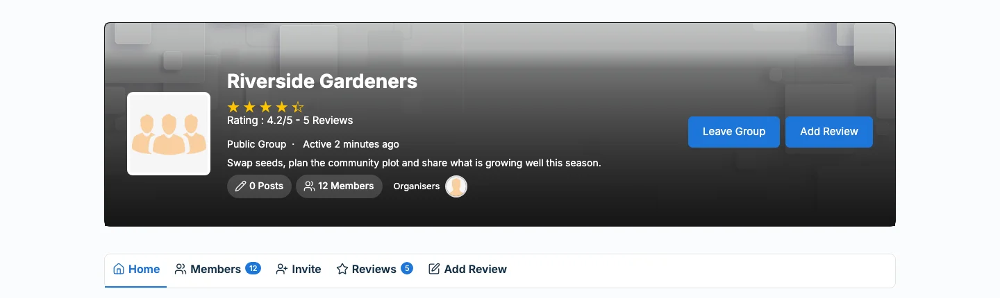
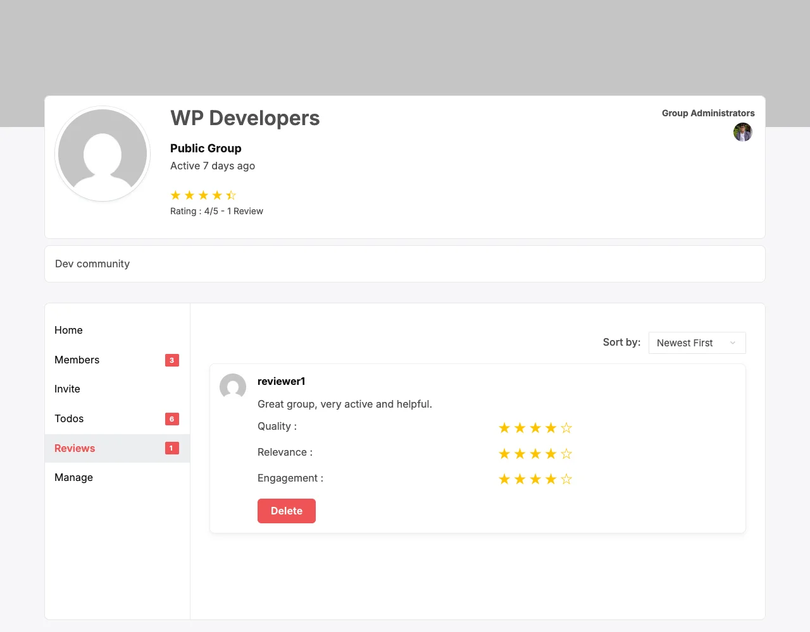
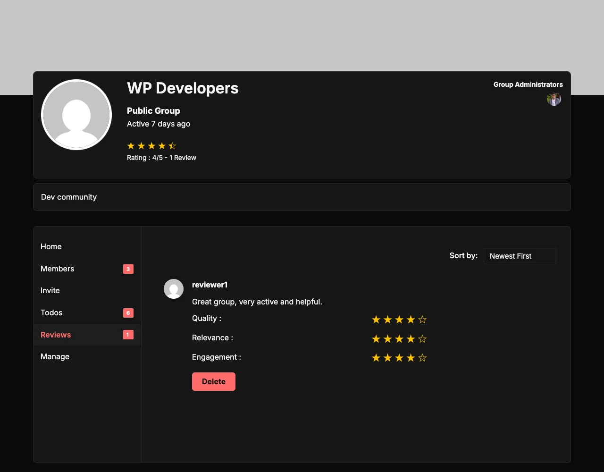
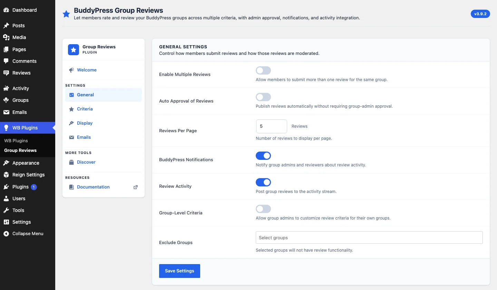
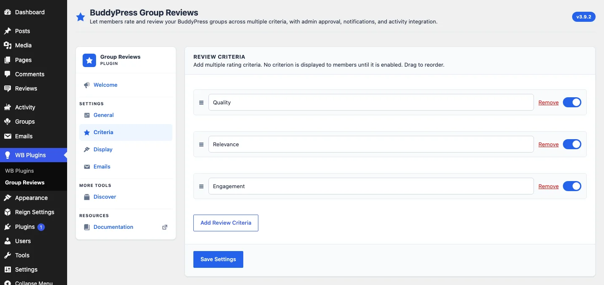
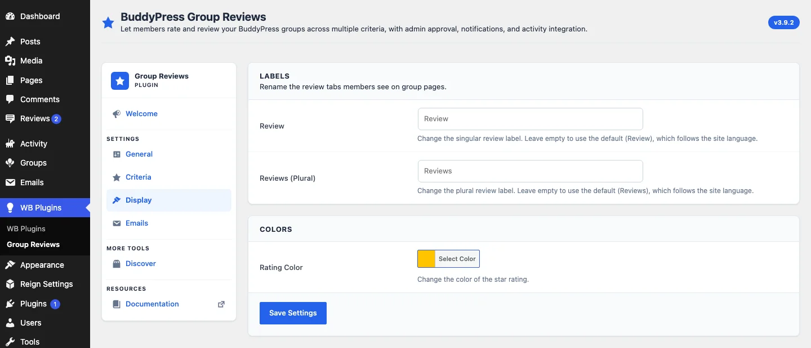
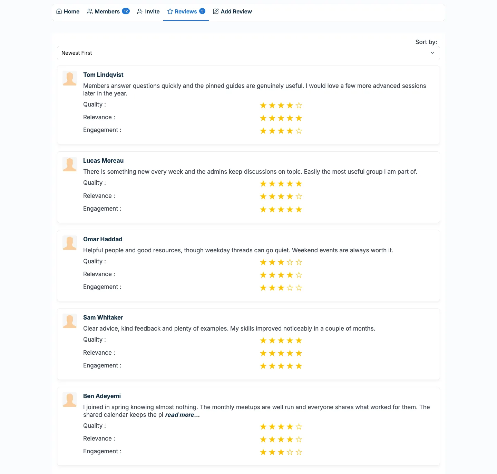
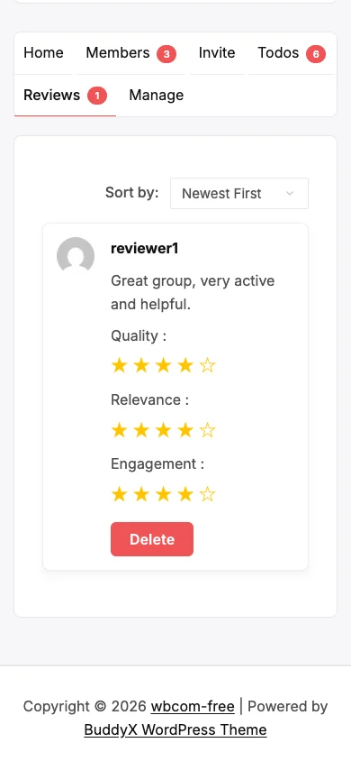
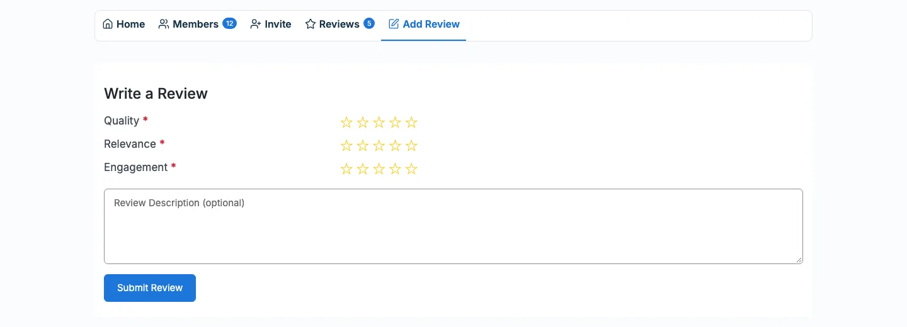
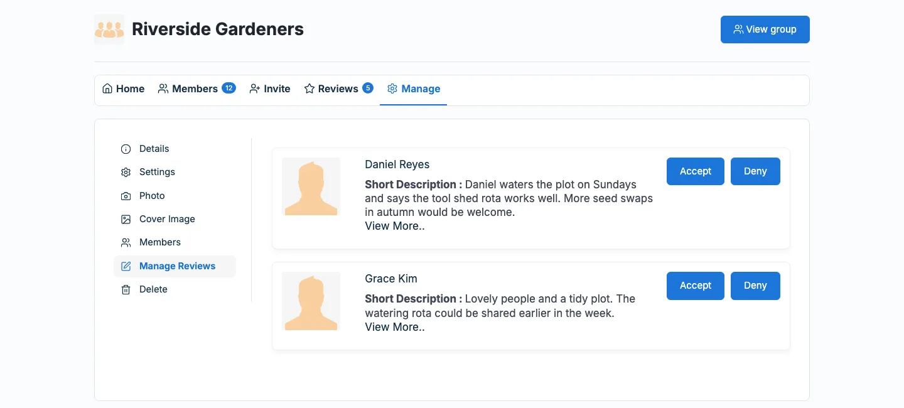

# BuddyPress Group Reviews - User Guide

## Welcome! 👋

This guide will help you understand and use the BuddyPress Group Reviews plugin. Everything is explained in simple language - no coding knowledge required!

---

## Table of Contents

1. [What Does This Plugin Do?](#what-does-this-plugin-do)
2. [Getting Started](#getting-started)
3. [Plugin Settings Explained](#plugin-settings-explained)
4. [How Members Use Reviews](#how-members-use-reviews)
5. [Managing Reviews as Group Admin](#managing-reviews-as-group-admin)
6. [Site Admin Features](#site-admin-features)
7. [Widgets](#widgets)
8. [Email Notifications](#email-notifications)
9. [Frequently Asked Questions](#frequently-asked-questions)
10. [Troubleshooting](#troubleshooting)

---

## What Does This Plugin Do?

### Simple Explanation
This plugin lets your BuddyPress community members **rate and review groups**, just like people review products on Amazon or restaurants on Yelp.

### Why is This Useful?

**For Community Members:**
- Discover which groups are most helpful
- Share their experience with groups
- See what others think before joining

**For Group Admins:**
- Get feedback from members
- Understand what people like/dislike
- Build trust and credibility

**For Site Owners:**
- Increase member engagement
- Help members find quality groups
- Make your community more active

### Real-World Example
Imagine you run a community about photography:
- Members can review the "Portrait Photography" group
- They might rate it 5 stars for "Helpfulness" and 4 stars for "Activity"
- New members can see these ratings and know it's a good group to join!

### How It Looks

**Single Group Header:**


*The group header shows the average star rating. The Reviews tab shows how many reviews the group has, and members who can review see an Add Review button and tab.*

**Reviews Tab:**


*The Reviews tab lists each review with its criteria ratings. This group uses the BuddyX theme.*


*Reviews follow the theme's dark mode.*

The groups directory also shows each group's average rating next to its card.

---

## Getting Started

### Requirements
- WordPress installed
- BuddyPress plugin active
- Groups component enabled in BuddyPress

### First Time Setup

1. **Install and Activate**
   - Upload the plugin to WordPress
   - Activate it from Plugins page
   - You'll be redirected to settings automatically!

2. **Configure Basic Settings**
   - Go to: **WB Plugins → Group Reviews**
   - Start with the "General" tab
   - Don't worry, we'll explain everything below!

---

## Plugin Settings Explained

### General Settings Tab


*General Settings tab with review options*

#### 1. **Enable Multiple Reviews**
- **What it does:** Lets members submit more than one review for the same group
- **When to enable:**
  - ✅ If groups change over time and you want updated feedback
  - ✅ For active communities where circumstances change
- **When to disable:**
  - ❌ If you only want one opinion per member
  - ❌ To prevent spam or duplicate reviews

**Example:** If enabled, John can review the "WordPress Help" group in January, then again in June if things have improved.

---

#### 2. **Auto Approval of Reviews**
- **What it does:** Reviews appear immediately without waiting for approval
- **When to enable:**
  - ✅ For trusted communities
  - ✅ When you want instant feedback visible
  - ✅ To reduce admin workload
- **When to disable:**
  - ❌ If you want to moderate content first
  - ❌ To prevent spam or inappropriate reviews
  - ❌ For sensitive communities

**Example:** With auto-approve ON, Sarah's review appears instantly. With it OFF, group admins must approve it first.

---

#### 3. **Reviews Per Page**
- **What it does:** How many reviews to show at once before pagination kicks in
- **Recommended:** 10-20 reviews
- **Why it matters:** Too many reviews on one page slows loading time

**Example:** Setting "15" means members see 15 reviews, then click "Next Page" for more.

---

#### 4. **BuddyPress Notifications**
- **What it does:** Shows notifications in BuddyPress notification bell
- **Difference from email:** Shows up in the site, not inbox. Emails are switched on and off per email in the [Emails Settings Tab](#emails-settings-tab)
- **Best practice:** Enable this - it's less intrusive than email

---

#### 5. **Review Activity**
- **What it does:** Posts reviews to BuddyPress activity feed
- **When to enable:**
  - ✅ To increase visibility of reviews
  - ✅ To encourage more participation
  - ✅ For active communities
- **When to disable:**
  - ❌ If activity feed gets too cluttered
  - ❌ For private groups only

**Example:** When enabled, members see "John reviewed Photography Group" in their activity feed.

---

#### 6. **Group-Level Criteria**
- **What it does:** Lets each group admin customize the review criteria for their own group
- **When off:** Every group uses the site-wide criteria from the Criteria tab

---

#### 7. **Exclude Groups**
- **What it does:** Prevents certain groups from being reviewed
- **Use cases:**
  - Test groups
  - Admin-only groups
  - Groups that shouldn't be judged (like support groups)

**How to use:** Start typing group name, select from dropdown, click save.

---

### Criteria Settings Tab


*Configure review criteria that members rate*

#### What are Criteria?
**Criteria are the different aspects members rate.** Instead of just one overall star rating, you can have multiple categories.

#### Default Criteria:
- **Quality** - How good is the content?
- **Relevance** - Does the group stay on its topic?
- **Engagement** - Are members active and helpful?

#### Managing Criteria

**Add New Criteria:**
1. Click "Add Review Criteria"
2. Type the name in the new row
3. Click "Save Settings"

**Remove Criteria:**
1. Click "Remove" next to the criterion
2. Click "Save Settings"

**Enable/Disable Criteria:**
- Use the on/off switch at the end of each row
- Disabled criteria won't show in review form
- Old reviews keep their ratings

**Reorder Criteria:**
- Drag a row by its handle, then click "Save Settings"

**Best Practices:**
- Use 3-5 criteria (not too many!)
- Make them clear and specific
- Use words everyone understands
- Match your community's needs

**Examples by Community Type:**

**Learning Community:**
- Teaching Quality
- Content Clarity
- Member Support
- Resource Availability

**Professional Network:**
- Networking Opportunities
- Industry Relevance
- Professional Development
- Event Quality

**Hobby Community:**
- Fun Factor
- Member Friendliness
- Activity Level
- Resource Sharing

---

### Display Settings Tab

Customize how reviews appear on your site.


*Display tab with the review labels and the star color*

#### 1. **Review**
- **What it does:** Changes the singular word "Review", used on the "Add Review" button and tab
- **Default:** "Review" (leave empty to keep it, in the site's language)
- **Examples:**
  - "Feedback"
  - "Rating"
  - "Testimonial"

---

#### 2. **Reviews (Plural)**
- **What it does:** Changes the plural word "Reviews", used for the group's Reviews tab and the "Manage Reviews" screen group admins see
- **Default:** "Reviews" (leave empty to keep it, in the site's language)
- **Examples:**
  - "Feedback"
  - "Ratings"
  - "Testimonials"

---

#### 3. **Rating Color**
- **What it does:** Changes the color of rating stars
- **Default:** Gold
- **Why change it:** To match your site's design
- **How to use:** Click "Select Color", pick a color, save

**Design Tips:**
- Use colors that stand out
- Keep good contrast with background
- Stay consistent with your brand
- Test on mobile devices

---

### Emails Settings Tab

The Emails tab has three emails: review submitted (sent to the group admin), review approved and review denied (both sent to the reviewer). Each has its own on/off switch, subject and message.

Placeholders use square brackets, for example `[group-name]`. They are replaced when the email is sent.

#### 1. **Email Subject**
- **What it does:** Subject line of the email
- **Default (submission):** "New Review Submitted for Your Group [group-name] on [site-name]"
- **Subject placeholders:**
  - `[group-name]` - Name of the group being reviewed
  - `[site-name]` - Your site name

**Example:**
- Template: "New Review for [group-name]"
- Result: "New Review for WordPress Developers"

---

#### 2. **Email Message**
- **What it does:** Body text of the email
- **Message placeholders:**
  - `[group-name]` - Group name
  - `[user-name]` - Reviewer's name
  - `[review-link]` - Link to the review (the group's reviews page, or the wp-admin reviews list when moderation is on)
  - `[site-name]` - Your site name
  - `[admin-name]` - Group creator's name (submission email only)

**Example Template:**
```
Hello [admin-name],

A new review has been submitted for your group [group-name] by [user-name].

View it here: [review-link]
```

**Tips:**
- Keep it friendly and conversational
- Include the link so admins can view easily
- Don't make it too long
- Test it by submitting a review yourself

---

## How Members Use Reviews

### Viewing Reviews

The Reviews tab shows approved reviews with their criteria ratings.


*The Reviews tab with the Sort by menu. Long reviews are shortened with a read more link.*



**Where to Find Reviews:**
1. Go to any BuddyPress group
2. Look for the "Reviews" tab (or whatever you named it)
3. Click to see all published reviews

**What Members See:**
- Reviewer's name and photo
- Written review text (long reviews end in a "read more" link)
- Star ratings for each criterion
- A **Sort by** menu: Newest First, Oldest First, Highest Rated, Lowest Rated
- The group's average rating in the group header

---

### Submitting a Review

The Add Review form has a star selector for each criterion.


*The Add Review form. Every criterion needs a rating; the description is optional.*

**Step-by-Step for Members:**

1. **Find a Group to Review**
   - Browse groups
   - Can't review groups where you're an admin!

2. **Click Add Review**
   - Use the "Add Review" button in the group header
   - Or open the group's "Add Review" tab

3. **Fill Out the Form**
   - **Ratings:** Click stars to rate each criterion from 1 to 5 (required)
   - **Review Description:** Your written feedback (optional)

4. **Submit**
   - Click "Submit Review"
   - See confirmation message

5. **What Happens Next?**
   - **Auto-approve ON:** Review appears immediately
   - **Auto-approve OFF:** Group admin must approve first

---

### Review Best Practices for Members

**Good Reviews Are:**
- ✅ Honest and fair
- ✅ Specific with examples
- ✅ Balanced (mention good and bad)
- ✅ Respectful and constructive

**Bad Reviews Are:**
- ❌ Personal attacks
- ❌ Vague ("It's okay")
- ❌ Irrelevant complaints
- ❌ Spam or promotional

**Example of Good Review:**
> **Subject:** Great for Beginners!
>
> **Review:** I joined this WordPress group as a complete beginner three months ago. The members are incredibly patient and helpful. They have weekly video tutorials and respond to questions quickly. My only suggestion would be more advanced tutorials for intermediate users. Overall, highly recommended for anyone starting with WordPress!
>
> **Ratings:**
> - Quality: ⭐⭐⭐⭐⭐
> - Helpfulness: ⭐⭐⭐⭐⭐
> - Content: ⭐⭐⭐⭐

---

## Managing Reviews as Group Admin

### The Manage Reviews Tab

The Manage Reviews tab lists pending reviews with Accept and Deny buttons.


*Pending reviews waiting for the group admin*

**Where to Find It:**
1. Go to your group (where you're admin)
2. Click "Manage" menu
3. Look for "Manage Reviews" option

**What You See:**
- Pending reviews (when Auto Approval of Reviews is off)
- The reviewer's name and a short description, with "View More.." for the full text and ratings
- Accept and Deny buttons for each review

Published reviews are listed on the group's Reviews tab, where group admins can delete them.

---

### Approving Reviews

**When Auto-Approve is OFF:**

1. Go to Manage Reviews tab
2. See list of pending reviews
3. Read each review carefully
4. Click "Accept" or "Deny"

**Should You Approve?**
✅ **Approve if:**
- Review is honest and fair
- Follows community guidelines
- Even if it's negative (if constructive)

❌ **Deny if:**
- Contains spam or promotional content
- Uses offensive language
- Is completely off-topic
- Violates site rules

**Important:** Don't deny reviews just because they're negative! Honest criticism helps improve your group.

---

### Deleting Reviews

**When to Delete:**
- Review violates guidelines (even after approval)
- Contains personal information
- Is spam that got through
- Member requests removal

**How to Delete:**
1. Go to the group's Reviews tab
2. Find the review
3. Click "Delete" button
4. Confirm deletion

**Note:** Deletion is permanent! Consider carefully.

---

## Site Admin Features

As a WordPress site administrator, you have access to powerful tools for managing all reviews across your community.

### WordPress Admin Reviews List

**Where to Find It:**
Go to **WordPress Admin → Reviews** to see all reviews from every group.

**What You Can Do:**
- View all reviews (published and pending)
- Filter by status
- Search reviews
- Access quick actions

---

### Bulk Approve/Deny Reviews

**New in version 3.6.0!** Save time by approving or denying multiple reviews at once.

**How to Use Bulk Actions:**

1. **Go to Reviews List**
   - WordPress Admin → Reviews

2. **Select Reviews**
   - Check the boxes next to reviews you want to process
   - Use the checkbox at top to select all visible reviews

3. **Choose Action**
   - Select "Approve" or "Deny" from the Bulk Actions dropdown
   - Click "Apply"

4. **Confirmation**
   - You'll see a notice showing how many reviews were processed
   - Approved reviews are published immediately
   - Denied reviews are moved to trash

**When to Use:**
- ✅ After a community event generates many reviews
- ✅ When moderating a backlog of pending reviews
- ✅ To quickly clean up spam reviews

---

### Export Reviews to CSV

**Export all your review data for reporting or analysis.**

**How to Export:**

1. Go to **WordPress Admin → Reviews**
2. Click the **"Export to CSV"** button above the reviews list
3. A CSV file downloads automatically

**What's Included in Export:**
| Column | Description |
|--------|-------------|
| Review ID | Unique review identifier |
| Date | When the review was submitted |
| Status | Published or Draft (pending) |
| Reviewer | Member's display name |
| Reviewer Email | Member's email address |
| Group Name | Name of the reviewed group ("Unknown Group" if the group was deleted) |
| Group ID | BuddyPress group identifier |
| Review Title | The review's title |
| Review Content | The written review text |
| Average Rating | Overall rating (1-5) |
| Individual Ratings | One column per rating criterion found on the exported reviews: site-wide criteria plus each group's own criteria, including criteria a group has since removed |

**Use Cases:**
- Monthly community reports
- Identifying top-performing groups
- Spotting trends in feedback
- Sharing data with stakeholders
- Backing up review data

**Spreadsheet safety:** Since 3.9.2, any cell that starts with `=`, `+`, `-`, `@`, a tab or a carriage return gets a leading single quote. This stops a member's review text from running as a spreadsheet formula (OWASP CSV injection). You will see the extra `'` in those cells.

**Tips:**
- Open CSV in Excel, Google Sheets, or Numbers
- Use filters to analyze specific groups or time periods
- Charts can visualize rating trends over time

---

### Privacy Considerations

**Private Group Reviews:**
- Reviews for private or hidden groups are only visible to group members
- Activity stream posts for private group reviews are not shown sitewide
- This protects the privacy of your private communities

---

## Widgets

### Group Reviews Widget

**What it does:** Shows the top-rated groups, or the groups with the most reviews, in a sidebar or footer widget area.

**Setting it Up:**

1. Go to **Appearance → Widgets**
2. Find "Group Reviews Widget"
3. Drag it to a widget area (like the sidebar)
4. Configure options:
   - **Title:** Widget heading. It is printed by your theme, so it matches your other widgets.
   - **Number of groups:** How many to show (1 to 20).
   - **List type** and **Thumbnails:** Which groups to rank and whether to show their avatars.

When no group has a review yet, the widget shows one short sentence instead of a list.

---

### Group Rating Widget

**What it does:** Shows the ratings given to one group, with Latest, Highest and Lowest sort buttons.

**Where it works:** Only on a group page, because it shows the ratings of the group you are viewing. Add it to the widget area your theme provides for single groups. On other pages it has nothing to show.

**Setting it Up:**
1. Add the widget to the group page widget area
2. Set the title and how many ratings to show (1 to 20)

Widgets saved before 3.9.2 keep their title; saving them again stores it under the new setting.

---

## Using Group Reviews with Member Reviews

Group Reviews and BuddyPress Member Reviews store their reviews in the same `review` post type, so both appear in the one Reviews list in wp-admin. A Group Review is tied to a group, a Member Review to a member. Group Reviews only counts and shows Group Reviews, and the CSV export only contains Group Reviews. Member Reviews 3.8.3 keeps its Flagged and Auto-hidden views to Member Reviews. See the [compatibility guide](member-reviews-compatibility.md) for the details.

---

## Email Notifications

### For Group Admins

**What Triggers Emails:**
- New review submitted (if notifications enabled)
- Review needs approval (if auto-approve is off)

**Email Contains:**
- Reviewer's name
- Group name
- Link to view/manage the review

**Controlling Email Frequency:**
- Enable/disable in Email Settings
- Consider disabling if you get too many
- BuddyPress notifications are less intrusive alternative

---

### For Reviewers

**Members receive notifications when:**
- Their review is approved (if auto-approve was off)
- They get a reply (future feature)

---

## Frequently Asked Questions

### General Questions

**Q: Who can submit reviews?**
A: Any logged-in member can review groups where they're not an admin.

**Q: Can I review my own group?**
A: No, group admins cannot review their own groups to prevent bias.

**Q: Can members edit their reviews?**
A: Not by default. They must delete and resubmit (if multiple reviews are allowed).

**Q: Are reviews anonymous?**
A: No, reviews show the member's name and profile picture.

**Q: Can I require members to join a group before reviewing?**
A: This is not built-in, but it's good practice to only review groups you've experienced.

---

### Settings Questions

**Q: What happens if I change criteria?**
A: Old reviews keep their ratings, but new reviews use the new criteria.

**Q: Can different groups have different criteria?**
A: Yes, when you turn on **Group-Level Criteria** (WB Plugins → Group Reviews → General). Each group admin can then use your global criteria, pick a subset, or add criteria for their own group. With the setting off, every group uses your site-wide criteria.

**Q: What happens to reviews if I exclude a group?**
A: Existing reviews remain, but the "Add Review" button disappears.

**Q: Can I bulk manage reviews?**
A: Yes! Site administrators can use bulk actions in WordPress Admin → Reviews to approve, deny, or delete multiple reviews at once. See the [Site Admin Features](#site-admin-features) section.

**Q: Can I export review data?**
A: Yes! Go to WordPress Admin → Reviews and click "Export to CSV" to download all review data for reporting or analysis.

---

### Technical Questions

**Q: Will reviews slow down my site?**
A: No, the plugin is optimized for performance with proper caching.

**Q: Are reviews searchable?**
A: Yes, they're stored as WordPress posts so they appear in search results.

**Q: Do reviews work with mobile?**
A: Yes, the plugin is fully responsive and mobile-friendly.

**Q: Is it compatible with my theme?**
A: Yes, it works with any BuddyPress-compatible theme.

**Q: Does it work with BuddyBoss?**
A: Yes! Fully compatible with BuddyBoss Platform.

**Q: What happens when I uninstall the plugin?**
A: By default, your review data is kept safe when you deactivate or delete the plugin. If you want to completely remove all review data, add this line to your wp-config.php before uninstalling: `define( 'BGR_REMOVE_DATA_ON_UNINSTALL', true );`

---

## Troubleshooting

### Reviews Not Showing

**Problem:** Can't see reviews on group page.

**Solutions:**
1. Check if "Reviews" tab exists in group navigation
2. Verify BuddyPress Groups component is active
3. Check if the group is excluded from reviews
4. Clear browser cache
5. Check if any reviews are published

---

### Can't Submit Review

**Problem:** "Add Review" button missing or not working.

**Solutions:**
1. **Check if you're logged in** - Must be a member
2. **Check if you're a group admin** - Can't review your own group
3. **Check if group is excluded** - Some groups don't accept reviews
4. **Check multiple review settings** - You may have already reviewed
5. **Try different browser** - Clear cache and cookies

---

### Email Notifications Not Working

**Problem:** Not receiving email notifications.

**Solutions:**
1. **Check the Emails tab** - Is "Enable Email" switched on for that email?
2. **Check spam folder** - Emails might be filtered
3. **Verify WordPress email** - Test with other WP emails
4. **Check notification preferences** - In your BuddyPress profile
5. **Contact host** - Some hosts block emails

---

### Stars Not Displaying Properly

**Problem:** Star ratings look broken or wrong color.

**Solutions:**
1. **Clear cache** - Browser and WordPress cache
2. **Check star color** - In Display Settings
3. **Check theme conflicts** - Try default WordPress theme
4. **Disable other plugins** - Test for conflicts
5. **Check FontAwesome** - Make sure it's loading

---

### Reviews Stuck in Pending

**Problem:** Reviews not appearing even after approval.

**Solutions:**
1. **Check auto-approve** - Maybe it's turned off
2. **Verify approval** - Go to Manage Reviews tab
3. **Check review status** - In WordPress backend (the **Reviews** menu in the WordPress admin sidebar, added by Member Reviews)
4. **Clear cache** - Site cache might be showing old data

---

## Need More Help?

### Support Resources

**Official Support:**
- Website: [wbcomdesigns.com/contact](https://wbcomdesigns.com/contact)
- Documentation: Check the other guides in `/docs` folder
- Video Tutorials: [vimeo.com/556662460](https://vimeo.com/556662460)

**Community Support:**
- WordPress.org Forums: [wordpress.org/support/plugin/buddypress-groups-review](https://wordpress.org/support/plugin/review-buddypress-groups/)
- GitHub Issues: For bug reports and feature requests

**Before Asking for Help:**
1. Check this guide first
2. Search the forums
3. Try troubleshooting steps
4. Have your plugin version ready
5. Note your WordPress and BuddyPress versions

---

## Tips for Success

### For Site Administrators

1. **Start with Good Settings**
   - Enable auto-approve for trusted communities
   - Use 3-5 clear criteria
   - Set reasonable reviews per page

2. **Moderate Fairly**
   - Don't delete negative reviews if they're honest
   - Respond to feedback constructively
   - Update group descriptions based on reviews

3. **Promote Reviews**
   - Encourage members to leave reviews
   - Feature highly-rated groups
   - Use widgets to showcase reviews

4. **Monitor Quality**
   - Check reviews regularly
   - Remove spam quickly
   - Adjust criteria based on usage

---

### For Group Admins

1. **Welcome Feedback**
   - Don't take negative reviews personally
   - Use them to improve your group
   - Thank reviewers for honest feedback

2. **Stay Active**
   - Good reviews come from active groups
   - Respond to member needs
   - Keep content fresh

3. **Ask for Reviews**
   - Politely remind members to review
   - Make it easy to find review button
   - Show appreciation for reviews

---

### For Members

1. **Be Thorough**
   - Spend time writing quality reviews
   - Rate all criteria fairly
   - Give specific examples

2. **Be Timely**
   - Review while experience is fresh
   - Update reviews if things change (if allowed)

3. **Be Respectful**
   - Criticism is okay, but be constructive
   - Focus on the group, not individuals
   - Follow community guidelines

---

## Conclusion

Congratulations! You now know how to use the BuddyPress Group Reviews plugin effectively.

**Remember:**
- Reviews help build a better community
- Honest feedback improves groups
- Quality reviews help others make decisions

**Have questions?** Check the Developer Guide or contact support!

---

**Plugin Version:** 3.9.2
**License:** GPL-2.0+
