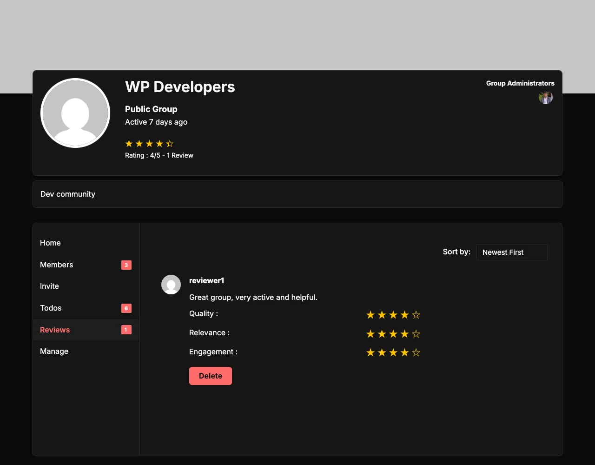

# Frequently Asked Questions

## Do I need BuddyPress?

Yes. BuddyPress or BuddyBoss Platform with the User Groups component on.

## Why is there no Reviews tab on a group?

You may not be a member, the group may be excluded, or the Groups component may be off. See [Troubleshooting](../troubleshooting/troubleshooting.md).

## Can group admins review their own group?

No. This keeps scores honest.

## Do reviews need approval?

By default yes. Turn on **Auto Approval of Reviews** to skip it.

## Can members edit a review after posting?

No. Members can write one review per group (or several, if you allow multiple reviews). Group admins and site admins can remove a review.

## Does it work with Member Reviews?

Yes. Both share the `review` post type and tell their reviews apart. See [Member Reviews compatibility](../developer-guide/member-reviews-compatibility.md).

## Does it work with dark mode?

Yes, with the dark mode toggle of BuddyX and Reign.

## What happens to reviews if I delete the plugin?

Nothing, unless you set `BGR_REMOVE_DATA_ON_UNINSTALL`.
