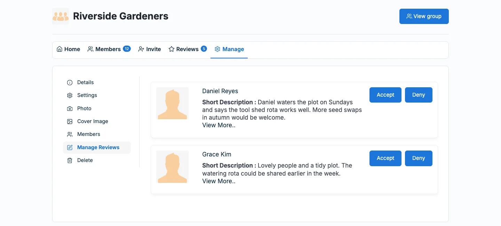

# Moderation

**Included in Free**

By default every new review waits for approval.

## Who can approve

- The admins of the group being reviewed.
- Site admins.

A group member or the admin of a different group cannot approve, deny or remove a review.

## Where to moderate

- On the group: **Manage > Manage Review** (the name follows your Review Label) lists pending reviews with **Approve** and **Deny** buttons.
- In wp-admin: **Reviews** has row actions and bulk actions.

If Approve, Deny or Delete is refused (for example the review was already handled), the message from the server appears in a notice instead of the page reloading.

Denied reviews move to the trash. The reviewer gets an email if you enabled it.

## Auto approval

Turn on **Auto Approval of Reviews** (General tab) to publish reviews immediately. See [Require Approval Before Reviews Go Live](../how-to/require-approval-for-reviews.md).

## Export

The **Reviews** list in wp-admin has an **Export to CSV** button for group reviews. Cells that start with a spreadsheet formula character are neutralised so a hostile review cannot run a formula in Excel.
