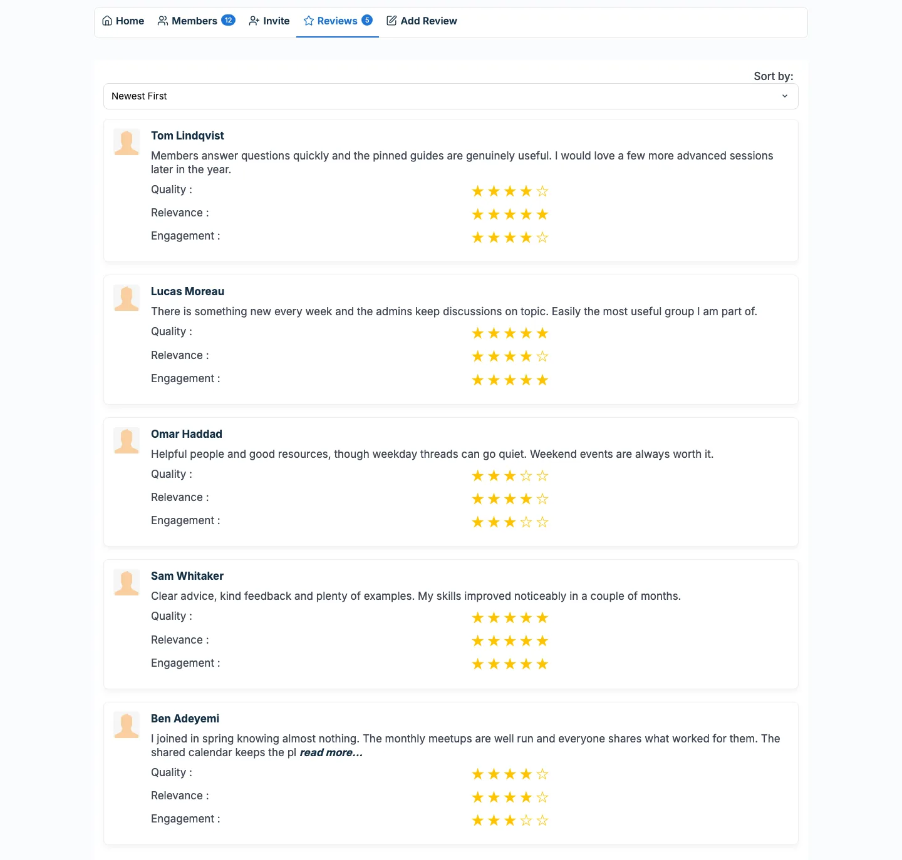

# Star Ratings and Criteria

**Included in Free**

A rating is a set of stars, one per criterion. The group score is the average of all published reviews.

## Site-wide criteria

The **Criteria** tab holds the list every group uses by default. Add, rename, reorder and switch criteria on or off. See [Set Up Rating Criteria](../how-to/set-up-rating-criteria.md).

## Group-level criteria

With **Group-Level Criteria** on (General tab), a group admin can pick the site-wide criteria that apply to their group and add custom ones. Open the group, click **Manage**, then **Review Criteria**. Archiving a custom criterion keeps the ratings already given.

## Where the score appears

- The group header, as stars and a line such as "Rating : 2.76/5 - 2,469 Reviews".
- The Reviews tab, with sorting by newest, oldest, highest rated and lowest rated.
- The groups directory, the Top Rated Groups widget and the leaderboard shortcode.

Scores are cached per group and refresh when a review is submitted, approved, denied or deleted.

