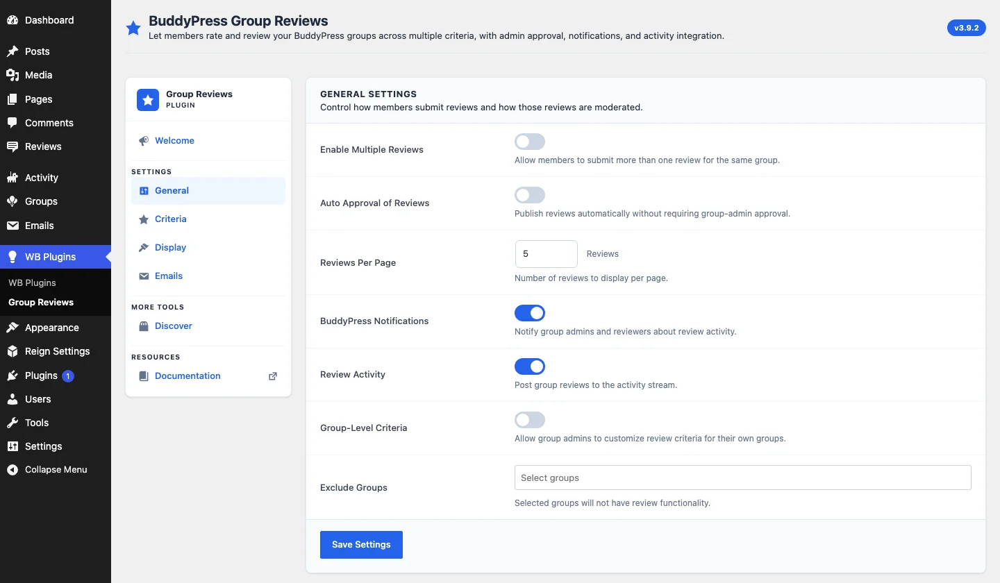

# Installation and Setup

**Included in Free**

Group Reviews lets members rate and review BuddyPress groups. Install it, turn on the Groups component and the plugin is ready to use with sensible defaults.

## Requirements

- WordPress 6.5 or higher and PHP 8.0 or higher.
- BuddyPress (or BuddyBoss Platform) with the **User Groups** component active.

If the Groups component is off, the plugin deactivates itself and shows a notice. Turn the component on at **Settings > BuddyPress > Components**, then activate the plugin again.

## Install

1. Go to **Plugins > Add New** and search for "Group Reviews", or upload the plugin zip.
2. Click **Activate**.
3. Open **WB Plugins > Group Reviews**.

## What works out of the box

- Members of a group see a **Reviews** tab on the group page.
- Reviews are held for approval until a group admin or site admin approves them.
- Three rating criteria are ready: Quality, Relevance and Engagement.
- Group admins cannot review their own group.

## Next steps

- Read the [Admin Screen Tour](admin-screen-tour.md) to find every setting.
- Decide whether reviews need approval: [Require Approval Before Reviews Go Live](../how-to/require-approval-for-reviews.md).
- Set your own rating criteria: [Set Up Rating Criteria](../how-to/set-up-rating-criteria.md).
