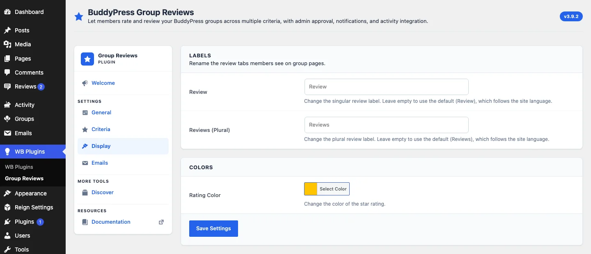

# Change the Wording and Star Color

**Included in Free**

1. Open **WB Plugins > Group Reviews > Display**.
2. Change **Review Label** (singular) and **Reviews Label (Plural)**, for example "Testimonial" and "Testimonials". Leave a field empty to keep the translated default.
3. Pick a **Rating Color** for the stars.
4. Click **Save Settings**.

The plural label also becomes the group tab name and its web address.

