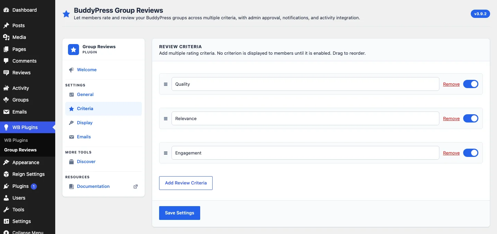

# Set Up Rating Criteria

**Included in Free**

1. Go to **WB Plugins > Group Reviews > Criteria**.
2. Click **Add** to add a criterion, for example "Moderation".
3. Drag the handle to reorder. Use the switch to turn a criterion off without deleting it.
4. Click **Save Settings**.

New reviews rate every active criterion. Reviews already submitted keep the ratings they were given. Renaming a criterion creates a new one, so the old ratings stay under the old name.
