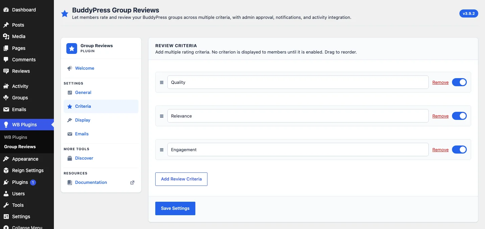
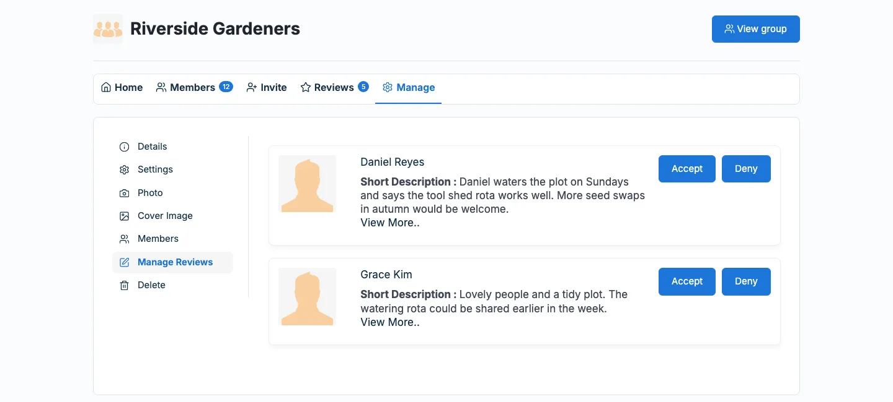
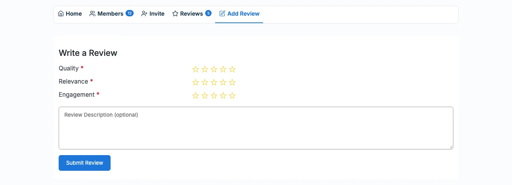
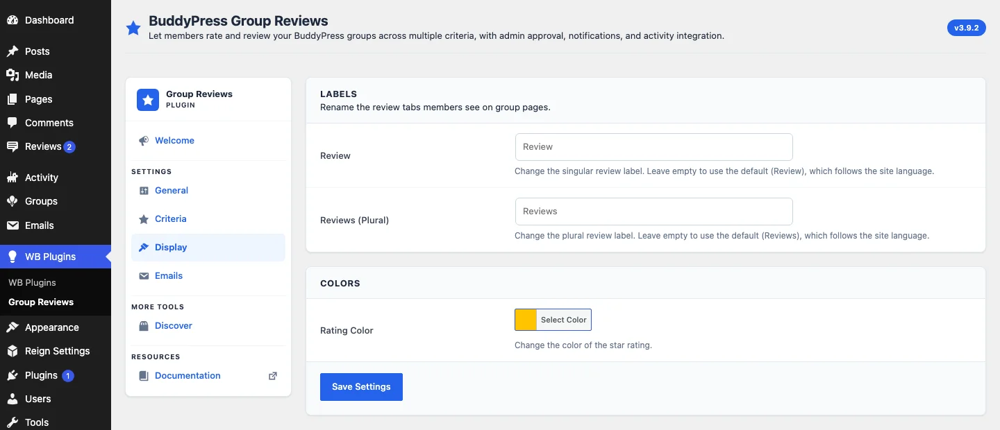
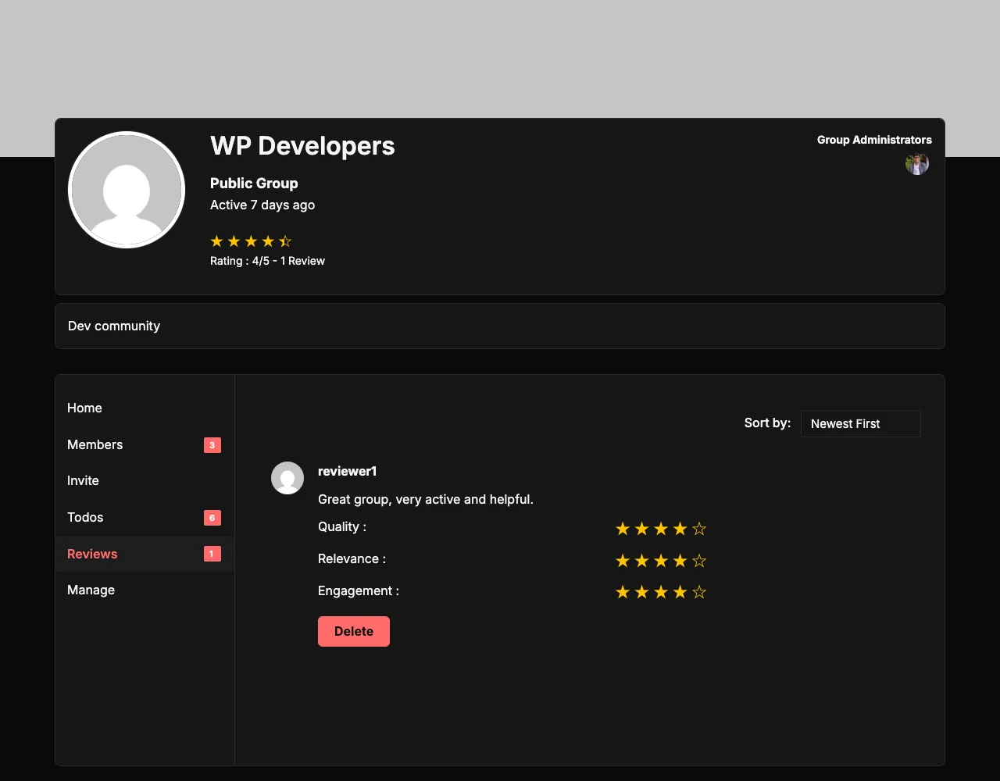

# Features Page Copy - BuddyPress Group Reviews

---

## Hero Section

### Headline
**Powerful Features for Community Group Reviews**

### Subheadline
Everything you need to collect, manage, and display member reviews for BuddyPress groups.

---

## Core Features

---

### Multi-Criteria Rating System

*Configure custom rating criteria in admin settings*

**What It Does:**
Create unlimited custom rating criteria so members can rate groups on multiple dimensions - not just a single star rating.

**The Benefit:**
Get detailed, actionable feedback that shows exactly what members love and what needs improvement, so group admins can focus on specific areas.

**Why It Matters:**
- Add criteria like "Communication," "Helpfulness," "Activity Level," "Welcoming Atmosphere"
- Enable or disable individual criteria without losing data
- Drag-and-drop to reorder criteria display
- Each criterion gets its own star rating (1-5)
- Overall average calculated automatically

---

### Review Moderation System

*Group admins accept or deny pending reviews*

**What It Does:**
Group admins approve or deny reviews before they appear publicly, giving you control over published content.

**The Benefit:**
Maintain quality standards and prevent spam without heavy-handed censorship - publish authentic reviews while filtering inappropriate content.

**Why It Matters:**
- New reviews go to moderation queue
- Group admins receive notification of pending reviews
- One-click approve or deny
- Optional auto-approval setting for trusted communities
- Manage all pending reviews from group admin panel

---

### BuddyPress Notifications

**What It Does:**
Native integration with BuddyPress Notifications component alerts group admins when new reviews are submitted.

**The Benefit:**
Never miss important feedback - get instant alerts within BuddyPress so you can respond quickly to member reviews.

**Why It Matters:**
- Appears in standard BuddyPress notification area
- Clickable links go directly to the review
- Works with BuddyBoss notification system
- No separate notification plugin required
- Respects user notification preferences

---

### Activity Stream Integration

**What It Does:**
Published reviews automatically post to the BuddyPress activity stream, visible to all members.

**The Benefit:**
Turn every review into community content that sparks conversations and showcases active, well-reviewed groups.

**Why It Matters:**
- Reviews appear in main activity feed
- Group-specific activity shows review in group stream
- Increases visibility of reviews
- Encourages more members to leave reviews
- Private group reviews stay within group activity only

---

### Email Notifications

**What It Does:**
Automated, customizable email notifications for new review submissions, approvals, and denials.

**The Benefit:**
Keep group admins and reviewers informed even when they're not logged in - no one misses important updates.

**Why It Matters:**
- Three email types: new submission, approval, denial
- Fully customizable subject lines and messages
- Placeholder variables: [group-name], [user-name], [site-name], [review-link]
- Enable/disable each email type independently
- Uses WordPress mail system for reliability

---

### Reviews Widget

**What It Does:**
Display group ratings and recent reviews in any widget area using the included WordPress widget.

**The Benefit:**
Showcase your best-rated groups in sidebars, footers, or any widget area - drive traffic to quality groups.

**Why It Matters:**
- Filter by rating (show only 4+ star groups)
- Display order options (highest rated, most reviewed, recent)
- Customizable widget title
- Show/hide star ratings
- Show/hide review count

---

### Group Rating Widget

**What It Does:**
A separate widget specifically for displaying group ratings with visual star display.

**The Benefit:**
Create visual impact with beautiful star rating displays that catch member attention and build trust.

**Why It Matters:**
- Prominent star visualization
- Shows total review count
- Links to group review page
- Customizable appearance
- Perfect for highlighting top groups

---

### Shortcode Support

*The review form members fill in on a group*

**What It Does:**
Use shortcodes to display the review form or review listings on any page or post.

**The Benefit:**
Place review functionality anywhere on your site - create dedicated review pages or embed in custom layouts.

**Why It Matters:**
- `[bgr_review_form]` - Display review submission form
- Works in pages, posts, and custom templates
- Pass group ID as parameter
- Flexible placement options
- Integrates with page builders

---

## Advanced Features

---

### REST API Integration

**What It Does:**
Full REST API access for reviews, ratings, and moderation - build custom interfaces and mobile apps.

**The Benefit:**
Integrate group reviews into mobile apps, headless frontends, or external systems with complete API access.

**Why It Matters:**
- GET endpoints for reviews and ratings
- POST endpoints for new reviews
- Standard WordPress REST API authentication
- JSON response format
- Documented endpoints

---

### Google Rating Schema

**What It Does:**
Automatic structured data markup that Google and other search engines understand.

**The Benefit:**
Get star ratings displayed in Google search results - increase click-through rates and visibility.

**Why It Matters:**
- AggregateRating schema automatically added
- Proper JSON-LD format
- Includes review count and average rating
- Improves SEO visibility
- No additional configuration needed

---

### Multiple Reviews Per User

**What It Does:**
Allow members to submit multiple reviews for the same group over time.

**The Benefit:**
Members can update their feedback as groups evolve - perfect for communities where groups change over time.

**Why It Matters:**
- Enable/disable in settings
- Members can review same group multiple times
- Prevents duplicate review spam when disabled
- Optional notice when multiple reviews disabled
- All reviews from same user are tracked

---

### Exclude Groups from Reviews

**What It Does:**
Select specific groups that should not have review functionality.

**The Benefit:**
Disable reviews for staff-only groups, test groups, or any group where reviews don't make sense.

**Why It Matters:**
- Multi-select group exclusion list
- Excluded groups don't show Reviews tab
- Excluded groups hidden from widgets
- Easy to manage from settings
- Useful for admin/staff groups

---

### Multisite Network Support

**What It Does:**
Full compatibility with WordPress Multisite installations.

**The Benefit:**
Deploy group reviews across your entire network with a single plugin installation.

**Why It Matters:**
- Network-wide activation option
- Site-specific settings
- Works with BuddyPress network installations
- Consistent functionality across sites
- Centralized management

---

### GamiPress Integration

**What It Does:**
Integration with GamiPress for gamification - trigger events when members submit reviews.

**The Benefit:**
Reward members for leaving reviews with points, badges, or other GamiPress rewards.

**Why It Matters:**
- Event triggers on review submission
- Works with GamiPress points and achievements
- Encourages more reviews through gamification
- Seamless integration when GamiPress is active
- No additional configuration required

---

## Display & Customization

---

### Customizable Labels

**What It Does:**
Change the "Review" and "Reviews" labels throughout the plugin to match your community's language.

**The Benefit:**
Use terminology that fits your community - call them "Feedback," "Testimonials," "Ratings," or anything else.

**Why It Matters:**
- Singular label (Review)
- Plural label (Reviews)
- Reflected throughout plugin
- Tab labels update automatically
- Professional, branded appearance

---

### Rating Star Colors

*Pick the star color and rename the review labels*

**What It Does:**
Customize the color of star ratings to match your site's branding.

**The Benefit:**
Seamlessly integrate review stars with your site design - no generic yellow stars that clash with your theme.

**Why It Matters:**
- Color picker in settings
- Applied to all star displays
- Default gold color (#FFC400)
- Instant preview
- Consistent across widgets and pages

---

### Reviews Per Page

**What It Does:**
Control how many reviews display per page before pagination.

**The Benefit:**
Optimize the review display for your layout - show more or fewer reviews based on your design.

**Why It Matters:**
- Numeric setting
- Standard WordPress pagination
- Works with themes and page builders
- Reduces page load on groups with many reviews
- User-friendly navigation

---

## Accessibility & Compatibility

---

### Accessibility Support

**What It Does:**
Built with accessibility in mind, including keyboard navigation and screen reader support.

**The Benefit:**
Ensure all members can use review functionality regardless of ability - inclusive by design.

**Why It Matters:**
- Proper ARIA labels
- Keyboard navigable forms
- Screen reader friendly
- WCAG-considerate design
- Focus management

---

### Theme Compatibility

*Reviews display beautifully across popular BuddyPress themes*

**What It Does:**
Tested and styled for popular BuddyPress themes including BuddyBoss, BuddyX, Reign, and Youzify.

**The Benefit:**
Works beautifully out of the box with the themes your community likely uses.

**Why It Matters:**
- BuddyBoss Theme support
- BuddyX compatibility
- Reign theme integration
- Youzify styling
- Standard BuddyPress themes

---

### Clean Uninstall

**What It Does:**
Optionally remove all plugin data when uninstalling, leaving no database clutter.

**The Benefit:**
GDPR-friendly and respectful of your database - when you're done, you're done.

**Why It Matters:**
- Optional complete data removal
- Removes custom database tables
- Clears all options
- Removes user meta
- Fresh start if reinstalling

---

## Requirements

| Requirement | Version |
|-------------|---------|
| WordPress | 6.5+ |
| PHP | 8.0+ |
| BuddyPress | 12.0+ |
| BuddyBoss Platform | Compatible |

---

## Get Started

**Ready to add reviews to your community?**

[Download Free →] | [View Documentation →]
