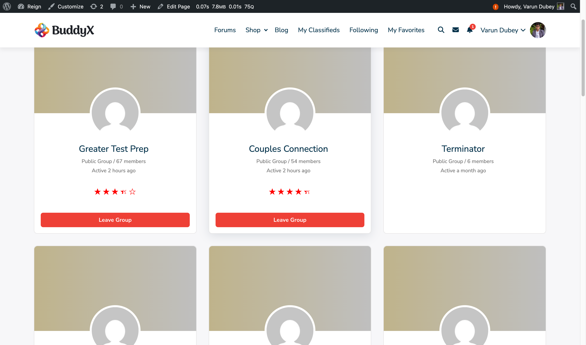
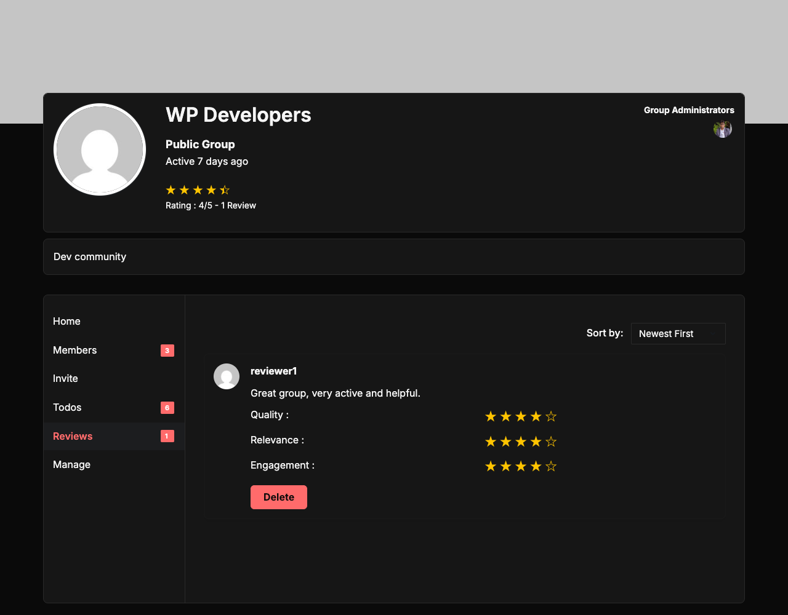
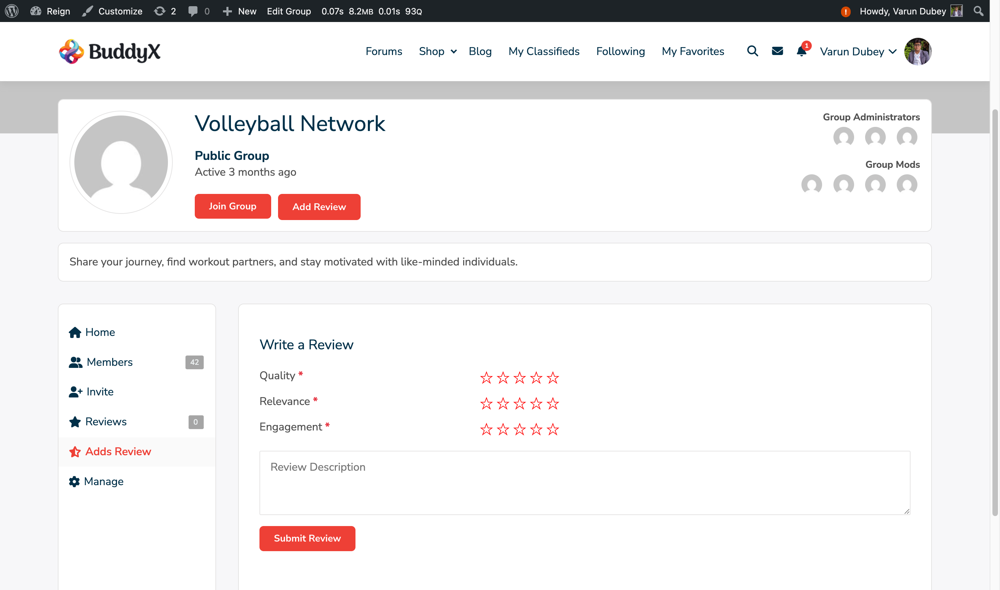
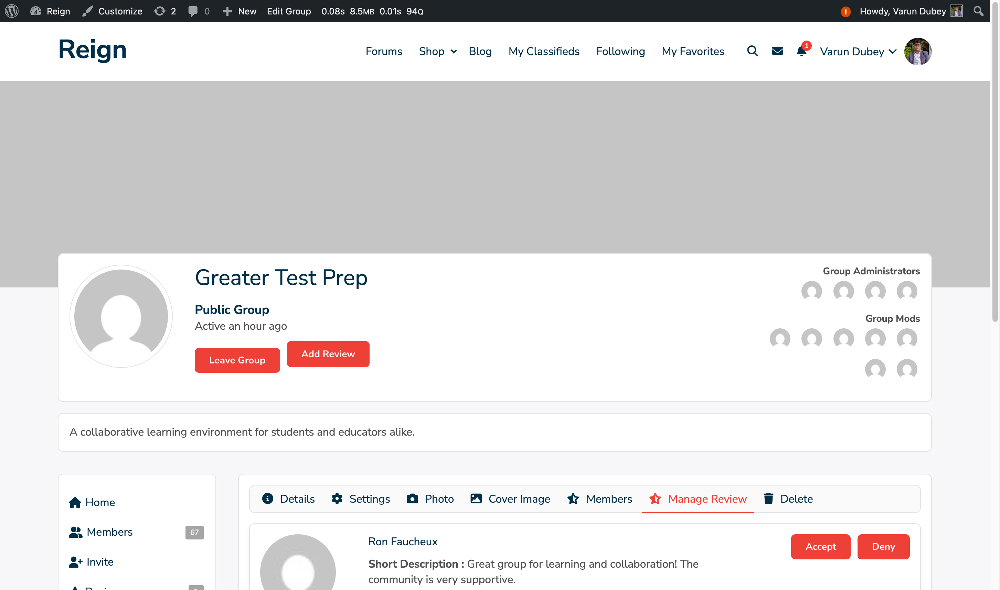

# Landing Page Copy - BuddyPress Group Reviews

---

## Hero Section

### Headline
**Give Your Community a Voice with Group Reviews**

### Subheadline
Let members rate and review BuddyPress groups with multi-criteria ratings, powerful moderation, and seamless integration—so the best groups rise to the top.

### Primary CTA
**Download Free** | View Features

### Hero Image

*Groups directory showing star ratings for each group*

---

## Social Proof Bar

**Trusted by Thousands of Communities**

- Compatible with WordPress 6.9+
- Works with BuddyPress 12.0+
- BuddyBoss Platform Ready
- 5-Star Reviews on WordPress.org

---

## Problem Section

### Headline
**Without Reviews, Your Community Flies Blind**

Members struggle to find quality groups. Group admins lack feedback. And you have no way to measure what's working.

**The result?**
- New members join random groups and leave disappointed
- Quality groups get overlooked while inactive ones persist
- Group admins don't know what members actually want
- Your community lacks the social proof that builds trust

---

## Solution Section

### Headline
**Member-Driven Reviews That Build Trust**

BuddyPress Group Reviews transforms your community with transparent, authentic feedback that helps everyone.

### Three-Column Benefits

**For Members**
Find groups worth joining with real ratings from real people. See what others think before you commit.

**For Group Admins**
Get actionable feedback on what's working and what needs improvement. Build a group people recommend.

**For Community Managers**
Understand group quality at a glance. Identify top performers and groups that need attention.

---

## Features Overview Section

### Headline
**Everything You Need for Group Reviews**

### Feature Grid (2x3)

#### Multi-Criteria Ratings
Define custom rating criteria that matter to your community. Rate groups on communication, content, activity level, and more.

#### Review Moderation
Approve or deny reviews before publishing. Maintain quality standards while giving members a voice.

#### BuddyPress Notifications
Native notifications alert group admins when reviews are submitted—no separate notification system needed.

#### Activity Stream Integration
Reviews appear in the activity feed, sparking conversations and showcasing active, well-reviewed groups.

#### Email Notifications
Automated emails for new reviews, approvals, and denials. Keep everyone informed even when they're offline.

#### Widgets & Shortcodes
Display top-rated groups anywhere with widgets and shortcodes. Showcase your best groups on any page.

---

## How It Works Section

### Headline
**Get Started in Minutes**

### Step 1: Install & Activate
Install from WordPress.org or upload the plugin. Activate and you're ready to configure.

### Step 2: Set Your Criteria
Define the rating criteria that matter to your community. Communication, helpfulness, activity—you decide.

*Configure custom rating criteria in admin settings*

### Step 3: Members Start Reviewing
Members visit groups and share their experiences. Reviews appear in a dedicated tab on each group page.

*Members rate each criteria with intuitive star selectors*

### Step 4: Moderate & Publish
Group admins review submissions and approve authentic feedback. Published reviews build social proof.

*Group admins can approve or deny reviews with one click*

---

## Advanced Features Section

### Headline
**Power Features for Serious Communities**

### REST API Integration
Build reviews into your mobile app or headless frontend. Full API access for custom development.

### Google Rating Schema
Structured data markup that Google understands. Get star ratings in search results to attract more traffic.

### Multiple Review Support
Let members update their reviews over time or submit new ones as groups evolve.

### Multisite Compatible
Deploy across your entire WordPress network from a single installation.

### GamiPress Integration
Reward members for leaving reviews. Connect with GamiPress for gamification and engagement.

### Theme Compatibility
Works beautifully with BuddyBoss, BuddyX, Reign, Youzify, and standard BuddyPress themes.

---

## Use Cases Section

### Headline
**Perfect for Every Type of Community**

### Membership Sites
Justify premium pricing with visible quality indicators. Help paying members find the best groups instantly.

### Educational Communities
Let students rate study groups, cohorts, and learning circles. Improve course-related groups with real feedback.

### Professional Networks
Build trust in industry groups with authentic peer reviews. Help professionals find valuable connections.

### Non-Profit Communities
Connect volunteers with active, well-organized groups. Showcase successful initiatives to donors.

### Hobby & Interest Groups
Help enthusiasts find their people. Surface the most active and welcoming groups in any niche.

---

## Testimonials Section

### Headline
**What Community Builders Say**

*[Placeholder for customer testimonials]*

> "Finally, a way to see which groups actually deliver value. Our members love being able to rate groups!"
> — *Community Manager, [Site Name]*

> "The moderation features give us control without censorship. We publish real feedback and our groups have improved."
> — *Site Administrator, [Site Name]*

> "REST API support meant we could add reviews to our mobile app. Game changer for our community."
> — *Lead Developer, [Agency Name]*

---

## Comparison Section

### Headline
**Why Choose BuddyPress Group Reviews?**

| Feature | Group Reviews | Generic Review Plugins | Custom Development |
|---------|--------------|----------------------|-------------------|
| Native BuddyPress Integration | Yes | No | Varies |
| Group-Specific Ratings | Yes | No | Varies |
| Activity Stream Integration | Yes | No | Extra Cost |
| BuddyPress Notifications | Yes | No | Extra Cost |
| Review Moderation | Yes | Sometimes | Extra Cost |
| REST API | Yes | Rarely | Extra Cost |
| Google Schema | Yes | Sometimes | Extra Cost |
| Ongoing Updates | Yes | Varies | Your Responsibility |
| Cost | Free / Affordable | Varies | $5,000+ |

---

## CTA Section

### Headline
**Ready to Give Your Community a Voice?**

### Subheadline
Join thousands of communities using BuddyPress Group Reviews to build trust and engagement.

### Primary CTA
**Download Free from WordPress.org**

### Secondary CTA
View Documentation | See All Features

---

## FAQ Preview Section

### Headline
**Common Questions**

**Does it work with BuddyBoss?**
Yes! Full compatibility with BuddyBoss Platform and BuddyBoss Theme.

**Can group admins delete bad reviews?**
Group admins can approve or deny reviews before publishing. This maintains quality while preventing abuse.

**Is there a Pro version?**
The free version includes all core features. Contact us for enterprise or custom development needs.

**[View All FAQs →]**

---

## Final CTA Section

### Headline
**Start Collecting Reviews Today**

### Subheadline
Free to download. Easy to set up. Powerful results.

### Primary CTA
**Get BuddyPress Group Reviews Free**

### Trust Elements
- Free forever core features
- Regular updates
- Dedicated support
- WordPress.org hosted

---

## Footer Notes

**Version:** 3.6.0
**Requires:** WordPress 6.0+ | BuddyPress 12.0+ | PHP 7.4+
**Author:** Wbcom Designs
**License:** GPLv2+
