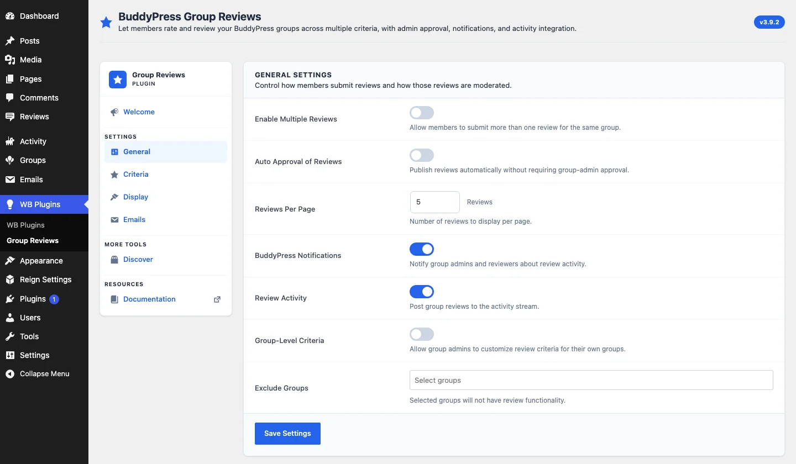
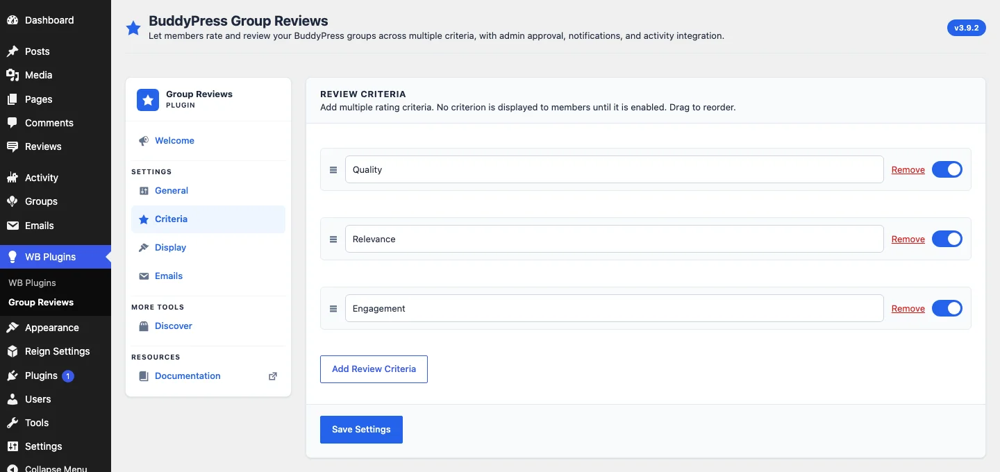
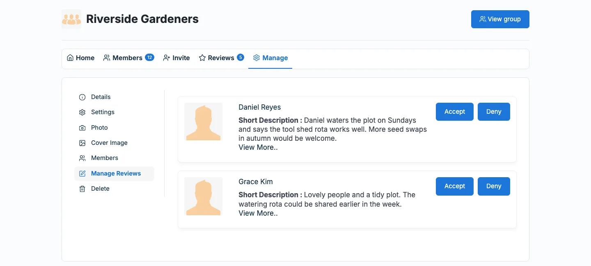
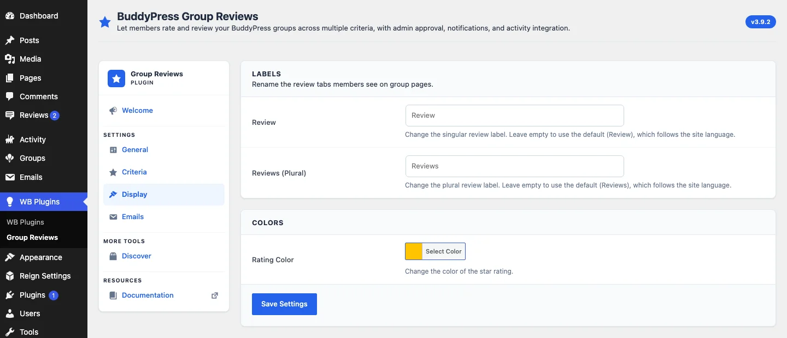
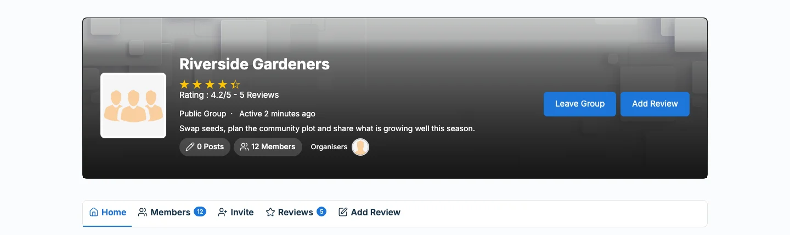
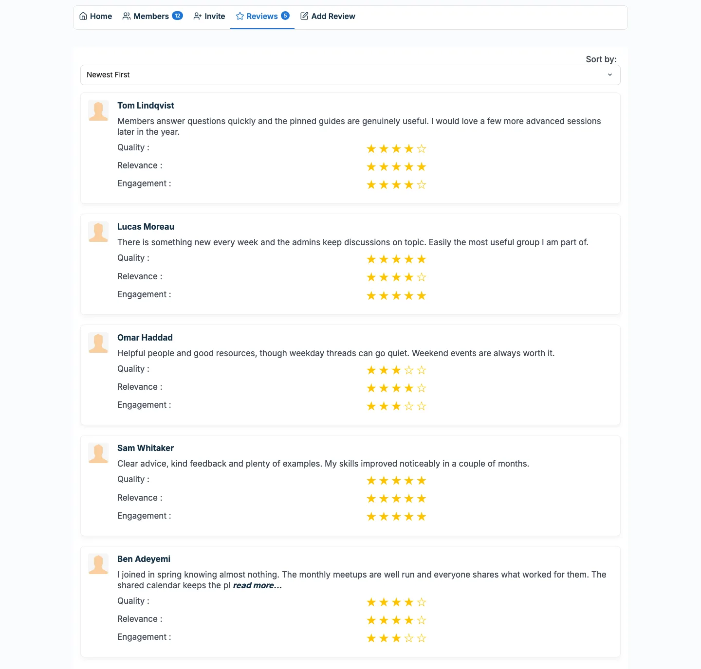
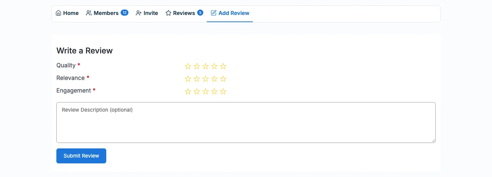

# Product Descriptions - BuddyPress Group Reviews

---

## WordPress.org Description (Short)

**Let your community rate and review BuddyPress groups.**

BuddyPress Group Reviews adds member-driven ratings and reviews to your BuddyPress groups. With multi-criteria star ratings, moderation tools, activity integration, and email notifications, you'll build trust and help members find quality groups.

---

## WordPress.org Description (Full)

**Give your community a voice with BuddyPress Group Reviews.**

Enable your members to rate and review BuddyPress groups with multi-criteria star ratings. After posting reviews, group admins can approve or deny them through a simple moderation interface. Approved reviews appear in a dedicated Reviews tab and in the activity stream.

### Screenshots

1. **General Settings** - Configure review options, notifications, and activity stream integration
   

2. **Review Criteria** - Define custom rating criteria for your community
   

3. **Manage Reviews** - Group admins approve or deny pending reviews
   

4. **Display Settings** - Customize labels and star colors
   

5. **Group Header** - Rating display in group header
   

6. **Reviews Tab** - Approved reviews with criteria ratings
   

7. **Add Review Form** - Members rate each criterion
   

**Key Features:**

- **Multi-criteria ratings** - Create custom rating criteria (Communication, Helpfulness, Activity Level, etc.)
- **Review moderation** - Group admins approve or deny reviews before publishing
- **BuddyPress notifications** - Group admins receive alerts for new reviews
- **Email notifications** - Customizable emails for submissions, approvals, and denials
- **Activity stream integration** - Reviews appear in the BuddyPress activity feed
- **Widgets** - Display group ratings and reviews in any widget area
- **Shortcode support** - Embed review forms on any page
- **Google rating schema** - SEO-friendly structured data for search visibility
- **REST API** - Build reviews into mobile apps and custom frontends
- **Exclude groups** - Disable reviews for specific groups
- **Multiple reviews** - Optionally allow members to submit multiple reviews
- **Multisite support** - Works with WordPress Multisite installations
- **GamiPress integration** - Reward members for leaving reviews

**Compatible with:**
- BuddyPress 12.0+
- BuddyBoss Platform
- BuddyX, Reign, Youzify themes

**Perfect for:**
- Membership communities
- Educational platforms
- Professional networks
- Non-profit organizations
- Hobby and interest groups

---

## One-Liner (Tagline)

**Member-driven reviews for BuddyPress groups that build trust and engagement.**

---

## 50-Word Description

BuddyPress Group Reviews lets community members rate and review groups with multi-criteria star ratings. Group admins moderate reviews before publishing, ensuring quality feedback. Features include BuddyPress notifications, activity integration, email alerts, widgets, REST API, and Google rating schema. Compatible with BuddyBoss, BuddyX, and major BuddyPress themes.

---

## 100-Word Description

Transform your BuddyPress community with member-driven group reviews. Let members rate groups using customizable criteria - Communication, Helpfulness, Activity Level, and more. Group admins moderate reviews before publishing, maintaining quality while giving members a voice.

Reviews integrate seamlessly with BuddyPress notifications and activity streams. Group ratings appear in the directory, helping members find quality groups instantly. Widgets and shortcodes let you showcase top-rated groups anywhere.

Advanced features include REST API for mobile apps, Google rating schema for SEO, GamiPress integration for gamification, and multisite support. Compatible with BuddyBoss Platform, BuddyX, Reign, and Youzify themes.

---

## 200-Word Description

**Give your community the transparency it deserves with BuddyPress Group Reviews.**

Enable members to rate and review groups using customizable star-rating criteria. Whether it's communication quality, activity level, or helpfulness - you decide what matters to your community. Group admins moderate reviews before publishing, ensuring authentic feedback while preventing spam.

**Seamless BuddyPress Integration**
Reviews appear in a dedicated tab on group pages and optionally in the activity stream. Group admins receive native BuddyPress notifications when new reviews arrive. Customizable email notifications keep everyone informed - even when offline.

**Built for Discovery**
Group ratings display prominently in the groups directory, helping members find quality groups at a glance. Widgets showcase top-rated groups in sidebars and footers. Google rating schema improves search visibility with rich snippets.

**Developer-Friendly**
Full REST API support enables mobile app and headless CMS integration. GamiPress compatibility lets you reward reviewers. Multisite support handles complex network installations.

**Theme Compatibility**
Works beautifully with BuddyBoss Platform, BuddyX, Reign, Youzify, and standard BuddyPress themes.

**Requirements:**
- WordPress 6.5+
- BuddyPress 12.0+ (Groups component active)
- PHP 8.0+

Start collecting authentic member feedback that builds trust and helps your community thrive.

---

## Marketplace Description (ThemeForest/CodeCanyon Style)

### BuddyPress Group Reviews - Member Ratings & Feedback Plugin

**Transform your BuddyPress community with authentic, member-driven group reviews.**

Let your community members rate and review groups using customizable multi-criteria star ratings. Build trust, improve engagement, and help members discover the best groups in your community.

---

#### Why Choose This Plugin?

**For Community Managers:**
Finally understand which groups deliver value. See ratings at a glance, identify underperforming groups, and use real feedback to improve your community.

**For Group Admins:**
Get actionable feedback from your members. Know what's working, what needs improvement, and build a group people love and recommend.

**For Members:**
Find groups worth joining. See what other members think before committing, and share your own experiences to help others.

---

#### Features at a Glance

| Feature | Included |
|---------|----------|
| Multi-criteria ratings | ✓ |
| Review moderation | ✓ |
| BuddyPress notifications | ✓ |
| Email notifications | ✓ |
| Activity stream integration | ✓ |
| Widgets (2 types) | ✓ |
| Shortcode support | ✓ |
| REST API | ✓ |
| Google rating schema | ✓ |
| Multiple reviews per user | ✓ |
| Exclude groups option | ✓ |
| Multisite support | ✓ |
| GamiPress integration | ✓ |
| Customizable labels | ✓ |
| Customizable star colors | ✓ |
| Clean uninstall option | ✓ |

---

#### Theme Compatibility

Tested and styled for:
- BuddyBoss Platform & Theme
- BuddyX / BuddyX Pro
- Reign Theme
- Youzify
- Standard BuddyPress themes

---

#### Requirements

- WordPress 6.5+
- PHP 8.0+
- BuddyPress 12.0+ (Groups component)
- OR BuddyBoss Platform

---

#### Support & Updates

- Regular updates for WordPress & BuddyPress compatibility
- Dedicated support from Wbcom Designs
- Active development with new features
- Comprehensive documentation

---

#### Get Started

Download now and start collecting member feedback that builds trust and drives engagement in your community.
